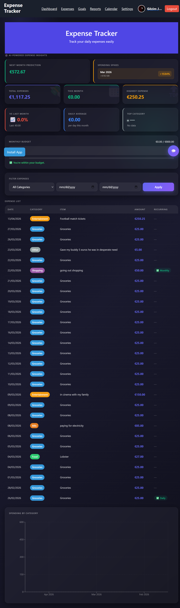
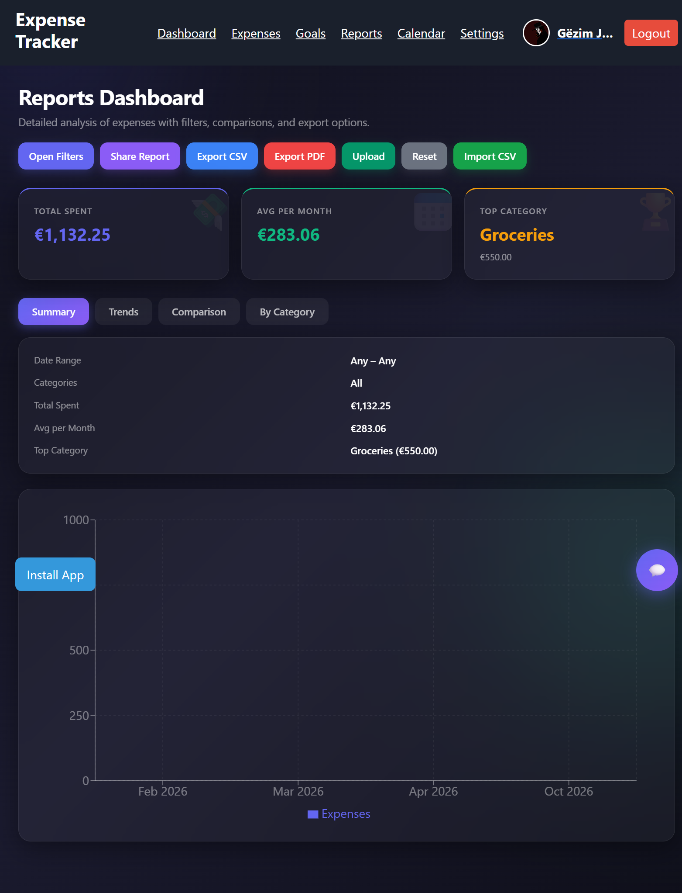
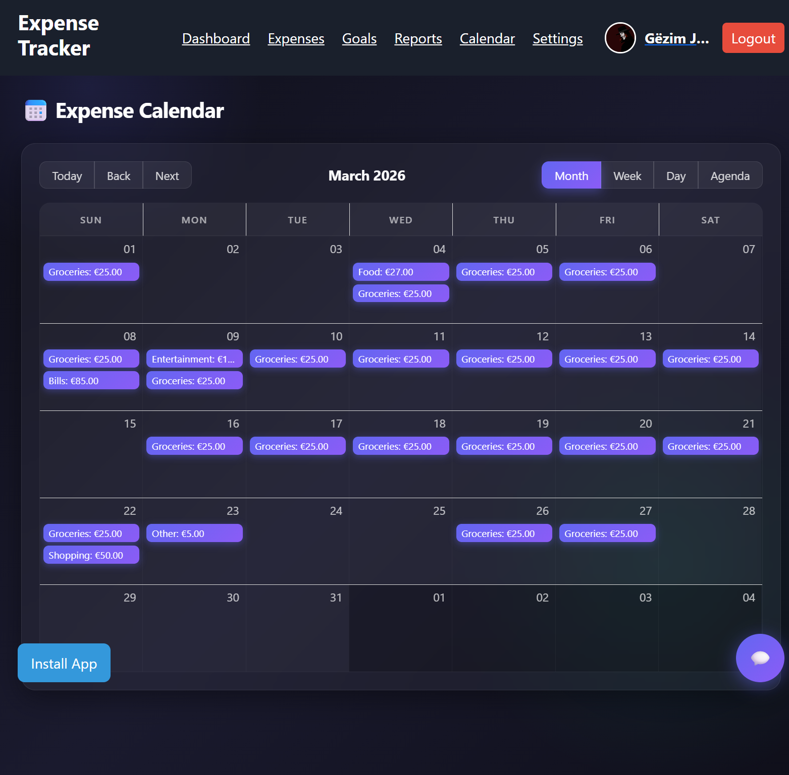

# Expense Tracker

A full-stack web app for tracking personal expenses, setting spending goals, and understanding where your money goes through charts and period-by-period reports. Installable as a PWA on desktop.

**Live demo:** https://expense-tracker-xi-eight-51.vercel.app



## Tech Stack

- **Frontend:** [React, Tailwind Css], deployed on Vercel
- **Backend:** [Node.js + Express], deployed on Render
- **Database:** MongoDB Atlas
- **Auth:** [JWT / sessions]
- **Charts:** [Chart.js / Recharts]

## Features

- User accounts: register, log in, and manage your profile (name, surname, password, profile picture)
- Add, edit, and delete expenses
- Set goals and track progress against them
- Search and filter expenses
- Reports with charts, including comparison between different time periods
- Calendar view showing expenses day by day
- Light and dark mode, plus a system-default setting
- Installable as a PWA (use "Install" in Chrome's address bar or popup)
- Responsive, modern UI

## Screenshots

| Dashboard | Reports | Calendar |
|---|---|---|
|  |  |  |

## How to Run Locally

### Backend

```
cd backend
npm install
cp .env.example .env   # add your MongoDB Atlas connection string and secrets
npm start
```

### Frontend

```
cd frontend
npm install
npm run dev
```

Then open http://localhost:3000 (adjust the port if yours differs).

## Environment Variables

| Variable | Description |
|---|---|
| `MONGODB_URI` | MongoDB Atlas connection string |
| `JWT_SECRET` | Secret used to sign auth tokens |

## Project Structure

```
expense-tracker/
├── backend/     # API, models, auth
├── frontend/    # UI, charts, PWA setup
└── screenshots/ # Screenshots of the live demo
```

## Notes

- Built as a personal project to practice full-stack development: database design, REST API, authentication, charts, and deployment.

License: MIT
